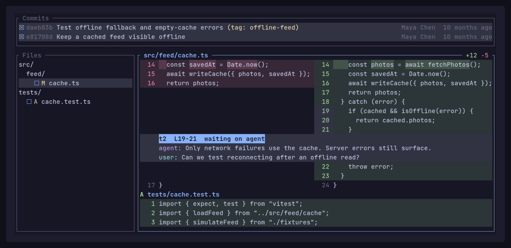
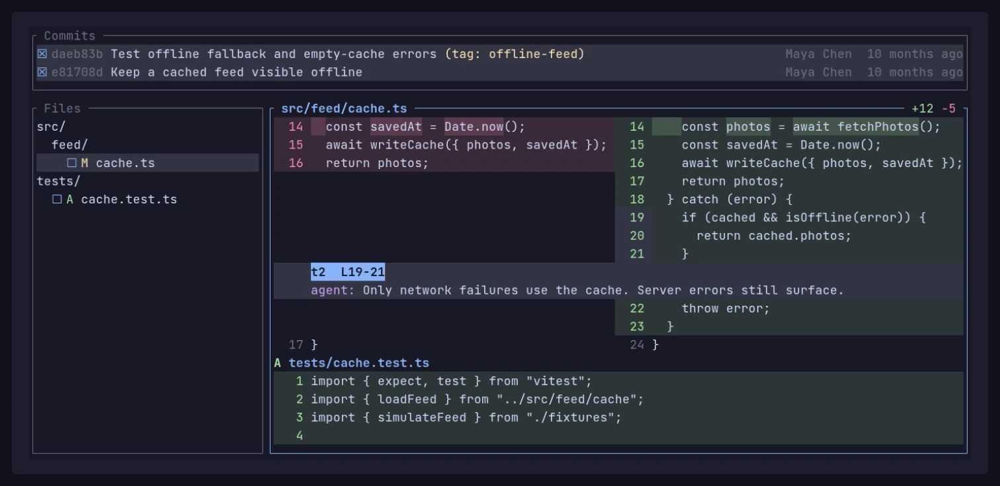
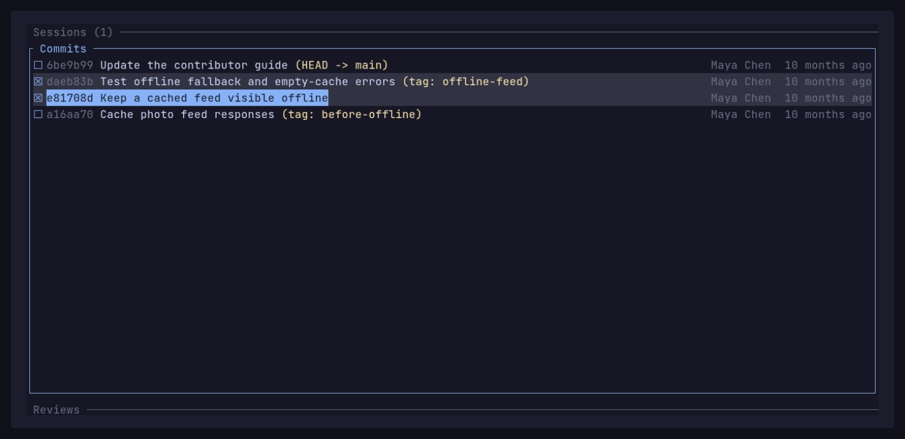

<h1 align="center">marginalia</h1>

<p align="center"><em>Review agent-written code, right where it changed.</em></p>



## Code review, as a conversation

**Discuss a change in context.**<br>
Ask the agent about the exact lines you’re reviewing.



**Review just the commits that belong together.**<br>
Select related commits and review their changes as one diff.



## Install

```sh
git clone https://github.com/yuhua99/marginalia.git
cd marginalia
cargo install --path crates/mrg
```

Install the skill:

```sh
npx skills add yuhua99/marginalia
```

## Usage

In your agent:

```
/human-review review latest 3 commits
```

Works best inside herdr/rex/tmux: the review opens in a new tab and the agent picks up when you quit. Elsewhere, the agent prints a command for you to run.

Run `mrg` to pick an open pull / merge request to review; needs [`gh`](https://cli.github.com) or [`glab`](https://gitlab.com/gitlab-org/cli).

## Acknowledgements

Inspired by [tuicr](https://github.com/agavra/tuicr).
